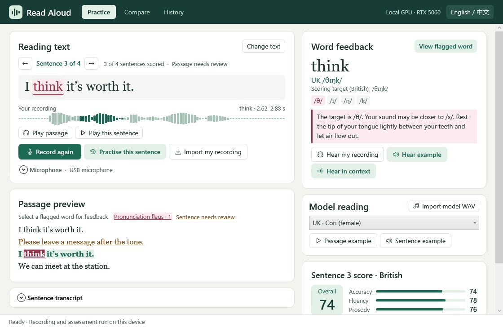

# Read Aloud Studio

[简体中文](README.md) · **English**

Read an English sentence or passage aloud on Windows and get feedback on individual words and sounds. Speech recognition and scoring run on your computer, using a British English pronunciation dictionary as the scoring reference. The interface is available in English and Simplified Chinese.

Select a flagged word to hear your recording or listen to the word in context in a model reading. You can import your own model reading as a WAV file, practise one sentence again, and compare the new take with the same sentence from your original recording.



## Build and run from source

You need Windows x64, Git, the .NET 10 SDK and a standalone 64-bit installation of CPython 3.11 with pip. Place the Python installation in `runtime\python` so that `runtime\python\python.exe` runs directly. Run these commands in PowerShell from the repository root.

```powershell
.\runtime\python\python.exe -m pip install -r .\source\requirements.txt -c .\source\runtime-lock.txt
git apply --directory=runtime/python/Lib/site-packages source/OpenPronounce-en-GB.patch
.\source\Fetch-Models.ps1
.\source\Build.ps1
.\ReadAloudStudio.exe
```

Apply the British English scoring patch once to a fresh installation of OpenPronounce 1.1.0. The model download script fetches pinned versions of the speech recognition, pronunciation assessment and British voice models. It checks the model weights and stores them in `engine/models`. After setup, you can practise offline. The app uses an NVIDIA GPU when available and can also run on the CPU.

## Try a sample recording

1. In **Practice**, choose **Change text**, select **After the rain (3 sentences)**, then click **Use this text**.
2. Choose **Import my recording** and open `samples/after-the-rain.wav` to score the sample.
3. To use that WAV as a listening reference, choose **Import model WAV** under **Model reading**. Select a word in the current sentence, then choose **Hear in context** to hear it with neighbouring words.

By default, your recordings, imported model readings and practice history are stored in `%LOCALAPPDATA%\ReadAloudStudio`. More detail is available in the Chinese-language [user guide](使用说明.txt) and [developer notes on the engine API and scoring](source/开发说明.txt).

## Third-party components

Read Aloud Studio uses OpenPronounce 1.1.0 with a British English scoring patch, British pronunciation dictionaries, Piper voices and NAudio. The repository includes [third-party licences and credits](source/licenses) and a [model manifest with sources, revisions and checksums](source/models.json).
